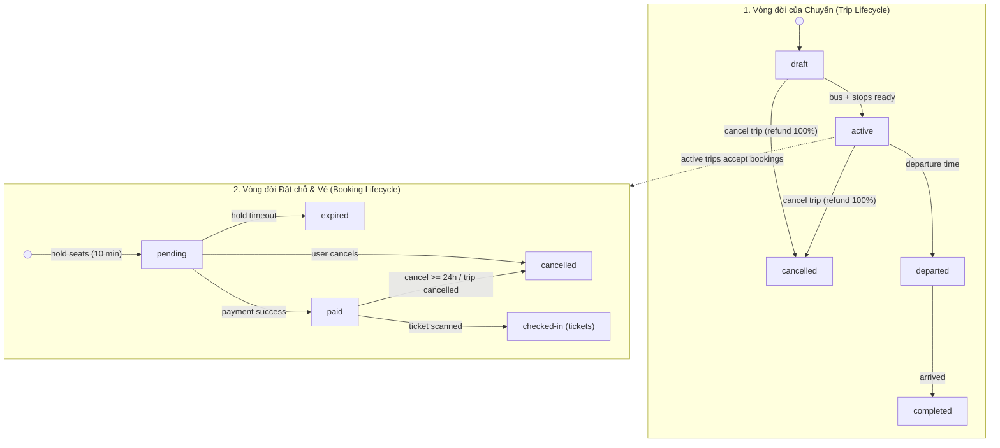

# KẾ HOẠCH CHI TIẾT TOÀN DIỆN: ĐỒ ÁN MÔN WEB APPLICATION DEVELOPMENT
## ĐỀ TÀI: HỆ THỐNG ĐẶT VÉ XE KHÁCH LIÊN TỈNH (BUS TICKET BOOKING SYSTEM)
**Quy mô & Mô hình chuẩn theo đề bài (`umt-fal26-project.pdf`):** Nhóm 5 sinh viên • Chia thành **5 nhóm chức năng Full-Stack** có khối lượng tương đương • **Mỗi thành viên phụ trách trọn vẹn 1 nhóm từ Dữ liệu (Database/Model) $\rightarrow$ Xử lý (Backend Controller/API) $\rightarrow$ Giao diện (Frontend EJS/Bootstrap/Tailwind/AJAX)**.

---

## I. MÔ TẢ DỰ ÁN & YÊU CẦU CHUNG BẮT BUỘC

### 1. Mô tả tổng quan hệ thống
Xây dựng ứng dụng web **“Bus Ticket Booking System”** – nền tảng đặt vé xe khách liên tỉnh tại Việt Nam, cho phép:
* **Tìm kiếm & Lọc chuyến thông minh:** Khách hàng tìm chuyến xe với gợi ý điểm đi, điểm đến tự động (`autocomplete`), lọc và sắp xếp kết quả.
* **Chọn ghế trực quan thời gian thực:** Chọn ghế trên sơ đồ ghế trực quan (1 hoặc 2 tầng); trạng thái ghế được cập nhật liên tục bằng AJAX trong lúc chọn và khóa ghế tạm thời 10 phút (`hold seats 10 min`).
* **Đặt vé & Thanh toán trọn vẹn:** Chọn điểm đón/trả, nhập thông tin hành khách, thanh toán qua cổng thanh toán giả lập, nhận vé điện tử (kèm mã QR) qua email; hỗ trợ hủy vé theo chính sách (trước giờ khởi hành $\ge 24\text{h}$).
* **Khách vãng lai (Guest Checkout):** Đặt vé không cần tài khoản và tra cứu/hủy vé bằng mã đặt chỗ (`booking_code`).
* **Trợ lý ảo (Chatbot):** Hỗ trợ 3 nghiệp vụ: **tìm chuyến**, **tra cứu vé** và **giải đáp chính sách**.
* **Quản trị & Vận hành nhà xe:** Quản trị viên (`admin`) quản lý bến xe, điểm đón/trả, tuyến, sơ đồ ghế, xe, chuyến, đặt chỗ, tin tức/khuyến mãi/chính sách/FAQ, người dùng; Nhân viên (`staff`) xem danh sách hành khách của chuyến và soát vé (`check-in`).
* **Báo cáo & Thống kê:** Thống kê doanh thu, số vé bán, tỉ lệ lấp đầy **theo thời gian** và **theo tuyến**.

### 2. Quy chuẩn kỹ thuật bắt buộc
1. **Kiến trúc SSR kết hợp AJAX:** Ứng dụng web render phía server (**SSR**) trên nền **Node.js, Express.js, EJS** và **PostgreSQL**; các thành phần tương tác động cập nhật một phần trang bằng **AJAX (`fetch` API)** không tải lại toàn trang.
2. **Giao diện & CSS Framework:** Giao diện hoàn toàn bằng **tiếng Việt**, tự động co giãn **Responsive** trên điện thoại, máy tính bảng và máy tính:
   * **Bootstrap 5:** Dùng cho toàn bộ ứng dụng chức năng chính (Trang chủ, Tìm chuyến, Chi tiết chuyến, Đặt vé, Thanh toán, Tra cứu vé, Đăng nhập/Đăng ký/Hồ sơ, Quản trị Admin, Nhân viên soát vé).
   * **Tailwind CSS:** Dùng cho các trang tĩnh (Giới thiệu nhà xe, Chính sách hoàn/hủy vé, Câu hỏi thường gặp - FAQ).
3. **Đóng gói & Quản lý mã nguồn:** Khởi chạy toàn bộ ứng dụng + PostgreSQL bằng **Docker Compose** (`docker compose up -d`) trên bất kỳ máy nào, tự động nạp sẵn dữ liệu mẫu (`Seed Data`) để demo; mã nguồn quản lý bằng **Git / GitHub** theo đúng 5 nhánh Full-Stack.

---

## II. VAI TRÒ NGƯỜI DÙNG & LUỒNG NGHIỆP VỤ CHÍNH

### 1. Bảng phân quyền 4 vai trò người dùng (Chuẩn đề bài)

| Vai trò | Mô tả | Quyền chính trong hệ thống |
| :--- | :--- | :--- |
| **Khách vãng lai (`guest`)** | Người dùng chưa đăng nhập | Tìm chuyến, xem chi tiết chuyến, đặt vé không cần tài khoản (*guest checkout*), tra cứu và hủy vé bằng mã đặt chỗ, xem tin tức/khuyến mãi/trang tĩnh, dùng trợ lý ảo (*chatbot*). |
| **Khách hàng (`customer`)** | Người dùng đã đăng ký và xác thực email | Toàn bộ các quyền của khách vãng lai; quản lý hồ sơ cá nhân; xem lịch sử đặt vé; hủy vé theo chính sách ($\ge 24\text{h}$ trước giờ khởi hành). |
| **Nhân viên (`staff`)** | Nhân viên nhà xe tại bến | Đăng nhập hệ thống nội bộ; xem danh sách hành khách của từng chuyến xe; thực hiện soát vé (*check-in*) hành khách lên xe. |
| **Quản trị viên (`admin`)** | Người quản lý hệ thống | Toàn quyền hệ thống: quản lý danh mục (bến xe, điểm đón/trả, tuyến, sơ đồ ghế, xe), quản lý chuyến & vòng đời chuyến, quản lý đặt chỗ, quản lý nội dung (tin tức, khuyến mãi, FAQ, chính sách), quản lý người dùng; xem dashboard & báo cáo thống kê. |

### 2. 5 Luồng nghiệp vụ chính
1. **Thiết lập hệ thống:** Admin đăng nhập $\rightarrow$ tạo bến xe, điểm đón/trả $\rightarrow$ tạo tuyến và điểm dừng $\rightarrow$ khai báo sơ đồ ghế, xe $\rightarrow$ lập lịch chuyến.
2. **Đăng ký tài khoản:** Khách đăng ký $\rightarrow$ xác thực email $\rightarrow$ đăng nhập $\rightarrow$ quản lý hồ sơ & xem lịch sử đặt vé.
3. **Đặt vé (Khách hàng `customer`):** Tìm chuyến $\rightarrow$ chọn chuyến $\rightarrow$ chọn ghế (giữ ghế 10 phút) $\rightarrow$ nhập thông tin $\rightarrow$ thanh toán giả lập $\rightarrow$ nhận vé điện tử qua email.
4. **Đặt vé (Khách vãng lai `guest`):** Tìm chuyến $\rightarrow$ chọn chuyến $\rightarrow$ chọn ghế (giữ ghế 10 phút) $\rightarrow$ nhập thông tin (không cần tài khoản) $\rightarrow$ thanh toán giả lập $\rightarrow$ nhận vé điện tử $\rightarrow$ tra cứu/hủy vé bằng mã đặt chỗ.
5. **Vận hành chuyến:** Admin tạo chuyến (`draft`) $\rightarrow$ gán xe $\rightarrow$ cấu hình điểm dừng $\rightarrow$ mở bán (`active`) $\rightarrow$ hành khách đặt vé $\rightarrow$ nhân viên soát vé (`checked-in`) $\rightarrow$ xe xuất bến (`departed`) $\rightarrow$ hoàn thành chuyến (`completed`).

### 3. Chi tiết 2 Vòng đời Trạng thái (Theo Hình 1 của Đề bài)



* **Quy tắc Vòng đời Chuyến (`trips.status`):**
  * Khi Admin mới tạo chuyến: trạng thái là `draft` (chưa mở bán).
  * Khi đã gán xe (`bus_id`) và cấu hình đủ điểm đón/điểm trả (`trip_stops`): chuyển sang `active`. **Chỉ chuyến `active` mới nhận đặt chỗ.**
  * Khi đến giờ khởi hành (`departure_time`): chuyển sang `departed` (khóa đặt vé). Khi xe tới bến cuối: chuyển sang `completed`.
  * Nếu hủy chuyến từ `draft` hoặc `active`: chuyển sang `cancelled` và **tự động hoàn tiền 100%** (`refund_amount = total_amount`) cho tất cả đơn đặt chỗ của chuyến đó, đồng thời chuyển các đơn/vé liên quan sang `cancelled`.
* **Quy tắc Vòng đời Đặt chỗ (`bookings.status` & `tickets.status`):**
  * Khi khách chọn ghế và bấm tiếp tục: giữ ghế trong **10 phút** (`hold seats 10 min`), tạo đơn `pending` (`hold_expires_at = NOW() + 10 minutes`) và vé `held`.
  * Từ `pending`:
    * Quá 10 phút chưa thanh toán (`hold timeout`): Job ngầm tự động chuyển đơn và vé sang `expired` để nhả ghế.
    * Khách chủ động bấm hủy (`user cancels`): chuyển sang `cancelled` và nhả ghế.
    * Thanh toán giả lập thành công (`payment success`): chuyển sang `paid`, sinh mã vé điện tử QR và gửi email vé điện tử.
  * Từ `paid`:
    * Nhân viên quét/nhập mã vé tại bến (`ticket scanned`): chuyển trạng thái vé sang `checked_in` (ghi nhận `checked_in_at`, `checked_in_by`).
    * Khách hủy vé trước giờ khởi hành $\ge 24\text{h}$ hoặc chuyến xe bị hủy (`cancel >= 24h / trip cancelled`): chuyển sang `cancelled` và nhả ghế.

---

## III. PHÂN CÔNG NHIỆM VỤ 5 THÀNH VIÊN FULL-STACK (CHUẨN MỤC 3 ĐỀ BÀI)

> **Nguyên tắc bắt buộc từ đề bài:** *"Các chức năng được chia thành 5 nhóm full stack có khối lượng tương đương; mỗi thành viên phụ trách trọn vẹn một nhóm. Mỗi nhóm chức năng do một thành viên phụ trách từ dữ liệu, xử lý đến giao diện."*

### Bảng tổng hợp 5 Nhóm chức năng theo đúng Đề bài

| Thành viên | Nhóm chức năng (Chuẩn đề bài) | Phạm vi phụ trách nguyên văn theo đề bài | Nhánh Git phụ trách |
| :--- | :--- | :--- | :--- |
| **Thành viên 1** | **Nhóm 1: Tài khoản, xác thực và bảo mật** | Đăng ký, xác thực email, đăng nhập, quên mật khẩu; hồ sơ, lịch sử đặt vé; phân quyền; quản lý người dùng; bảo mật chung. | `feat/member1-auth` |
| **Thành viên 2** | **Nhóm 2: Danh mục vận hành và nội dung** | Giao diện quản trị chung; bến xe, điểm đón/trả, tuyến, sơ đồ ghế, xe; tin tức, khuyến mãi, FAQ, chính sách; trang tĩnh. | `feat/member2-catalog` |
| **Thành viên 3** | **Nhóm 3: Lịch chạy và tìm kiếm chuyến** | Giao diện khách hàng chung; quản lý chuyến, lập lịch, điểm dừng, vòng đời chuyến; trang chủ, tìm chuyến, chi tiết chuyến. | `feat/member3-trips` |
| **Thành viên 4** | **Nhóm 4: Đặt vé, chọn ghế và thanh toán** | Sơ đồ chọn ghế, giữ ghế; quy trình đặt vé; thanh toán giả lập; tra cứu, hủy vé; dữ liệu dùng chung. | `feat/member4-booking` |
| **Thành viên 5** | **Nhóm 5: Vé điện tử, vận hành, báo cáo và trợ lý ảo** | Vé điện tử, email vé; quản lý đặt chỗ; soát vé; dashboard, báo cáo; trợ lý ảo; triển khai, kiểm thử tích hợp. | `feat/member5-tickets-report` |

---

### Chi tiết công việc Full-Stack (Dữ liệu $\rightarrow$ Xử lý $\rightarrow$ Giao diện) của từng Thành viên

#### 1. THÀNH VIÊN 1 — Nhóm 1: Tài khoản, xác thực và bảo mật
* **Phạm vi đề bài:** Đăng ký, xác thực email, đăng nhập, quên mật khẩu; hồ sơ, lịch sử đặt vé; phân quyền; quản lý người dùng; bảo mật chung.
* **Tầng Dữ liệu (Database & Model):**
  * Phụ trách bảng `users` và kết nối Pool PostgreSQL (`src/config/db.js`).
  * Viết toàn bộ truy vấn SQL trong `src/models/user.model.js`: tạo tài khoản, lưu/kiểm tra `verify_token` và `reset_token`, cập nhật hồ sơ, đổi mật khẩu, truy vấn lịch sử đặt vé của khách hàng (`customer`), danh sách & khóa/mở khóa/đổi vai trò người dùng cho `admin`.
* **Tầng Xử lý Backend (Controllers & Middlewares):**
  * Viết `src/middlewares/auth.middleware.js`: kiểm tra đăng nhập (`requireAuth`), phân quyền 4 vai trò (`guest`, `customer`, `staff`, `admin`), và các cơ chế bảo mật chung (mã hóa mật khẩu `bcryptjs`, bảo vệ session, chống SQL Injection bằng Parameterized Queries, lọc dữ liệu đầu vào).
  * Viết `src/controllers/auth.controller.js`: xử lý luồng Đăng ký $\rightarrow$ Gửi email xác thực $\rightarrow$ Kích hoạt tài khoản $\rightarrow$ Đăng nhập / Đăng xuất $\rightarrow$ Quên mật khẩu & Đặt lại mật khẩu $\rightarrow$ Cập nhật hồ sơ cá nhân $\rightarrow$ Xem lịch sử đặt vé $\rightarrow$ Admin quản lý người dùng.
* **Tầng Giao diện Frontend (Views EJS - Bootstrap 5):**
  * `src/views/auth/register.ejs` (Đăng ký tài khoản)
  * `src/views/auth/login.ejs` (Đăng nhập)
  * `src/views/auth/forgot-password.ejs` (Quên & đặt lại mật khẩu)
  * `src/views/auth/profile.ejs` (Quản lý hồ sơ cá nhân)
  * `src/views/auth/booking-history.ejs` (Xem lịch sử đặt vé & nút hủy vé của khách hàng)
  * `src/views/admin/users.ejs` (Màn hình Admin quản lý người dùng, khóa/mở khóa, phân quyền)
  * `src/views/emails/verify-email.ejs` (Mẫu HTML email xác thực tài khoản & đặt lại mật khẩu)

#### 2. THÀNH VIÊN 2 — Nhóm 2: Danh mục vận hành và nội dung
* **Phạm vi đề bài:** Giao diện quản trị chung; bến xe, điểm đón/trả, tuyến, sơ đồ ghế, xe; tin tức, khuyến mãi, FAQ, chính sách; trang tĩnh.
* **Tầng Dữ liệu (Database & Model):**
  * Phụ trách 5 bảng danh mục & nội dung: `stations` (bến xe & điểm đón/trả), `routes` (tuyến xe), `seat_layouts` (sơ đồ ghế mẫu JSONB), `buses` (đội xe), `articles` (tin tức, khuyến mãi, chính sách, FAQ).
  * Viết toàn bộ truy vấn SQL trong `src/models/catalog.model.js`: CRUD bến xe/điểm đón trả, CRUD tuyến đường, CRUD sơ đồ ghế mẫu, CRUD xe khách (kèm trạng thái `active`/`maintenance`), CRUD bài viết theo chuyên mục (`news`, `promotion`, `policy`, `faq`).
* **Tầng Xử lý Backend (Controllers & Core App):**
  * Quản lý khởi tạo ứng dụng `src/app.js` và viết `src/controllers/admin-catalog.controller.js`: xử lý toàn bộ nghiệp vụ CRUD danh mục vận hành cho Admin và render các trang tin tức, khuyến mãi, chính sách, FAQ, giới thiệu cho khách hàng.
* **Tầng Giao diện Frontend (Views EJS - Bootstrap 5 & Tailwind CSS):**
  * **Giao diện quản trị chung (Bootstrap 5):** `src/views/layouts/admin-layout.ejs` (Sidebar, Navbar Admin/Staff, Flash messages).
  * **Các màn hình quản trị danh mục (Bootstrap 5):**
    * `src/views/admin/catalog/stations.ejs` (Quản lý bến xe & điểm đón/trả)
    * `src/views/admin/catalog/routes.ejs` (Quản lý tuyến xe liên tỉnh)
    * `src/views/admin/catalog/seat-layouts.ejs` (Quản lý sơ đồ ghế mẫu 1 tầng / 2 tầng)
    * `src/views/admin/catalog/buses.ejs` (Quản lý đội xe & tiện ích)
    * `src/views/admin/catalog/articles.ejs` (Quản lý tin tức, khuyến mãi, FAQ, chính sách)
  * **Trang tin tức khách hàng (Bootstrap 5):** `src/views/customer/articles.ejs`.
  * **Các trang tĩnh dùng Tailwind CSS (Đúng yêu cầu đề bài):**
    * `src/views/static-tailwind/about.ejs` (Giới thiệu nhà xe)
    * `src/views/static-tailwind/policy.ejs` (Chính sách hoàn/hủy vé)
    * `src/views/static-tailwind/faq.ejs` (Câu hỏi thường gặp - FAQ)

#### 3. THÀNH VIÊN 3 — Nhóm 3: Lịch chạy và tìm kiếm chuyến
* **Phạm vi đề bài:** Giao diện khách hàng chung; quản lý chuyến, lập lịch, điểm dừng, vòng đời chuyến; trang chủ, tìm chuyến, chi tiết chuyến.
* **Tầng Dữ liệu (Database & Model):**
  * Phụ trách 2 bảng lịch chạy: `trips` (chuyến xe) và `trip_stops` (điểm dừng đón/trả của chuyến theo thứ tự `stop_order` và thời gian `stop_time`).
  * Viết toàn bộ truy vấn SQL trong `src/models/trip.model.js`:
    * Admin tạo chuyến (`draft`), gán xe (`bus_id`), cấu hình danh sách điểm đón/trả (`trip_stops`), kiểm tra điều kiện `bus + stops ready` để mở bán (`active`), chuyển trạng thái `departed`, `completed`, hoặc hủy chuyến (`cancelled` kèm hoàn tiền 100% cho các booking bị ảnh hưởng).
    * Khách hàng tìm kiếm chuyến xe đang `active`, gợi ý tự động tỉnh/bến xe (`autocomplete`), lọc theo khung giờ/giá vé/loại xe, sắp xếp theo giá/giờ khởi hành, tính số ghế trống còn lại, xem chi tiết chuyến & lộ trình điểm dừng.
* **Tầng Xử lý Backend (Controllers & AJAX API):**
  * Viết `src/controllers/admin-trip.controller.js`: quản lý lập lịch chuyến, cấu hình điểm dừng và điều khiển vòng đời chuyến (`draft` $\rightarrow$ `active` $\rightarrow$ `departed` $\rightarrow$ `completed` / `cancelled`).
  * Viết `src/controllers/customer-trip.controller.js`: render Trang chủ, Trang kết quả tìm kiếm, Trang chi tiết chuyến; cung cấp 2 API AJAX (`GET /api/provinces/suggest` và `GET /api/trips/filter`).
* **Tầng Giao diện Frontend (Views EJS - Bootstrap 5 & AJAX JS):**
  * **Giao diện khách hàng chung:** `src/views/layouts/customer-header.ejs` và `src/views/layouts/customer-footer.ejs`.
  * **Màn hình Admin quản lý chuyến:** `src/views/admin/trips/schedule.ejs` (Lập lịch chuyến, cấu hình điểm dừng, nút chuyển trạng thái theo vòng đời chuyến).
  * **Màn hình Khách hàng:**
    * `src/views/customer/home.ejs` (Trang chủ với bộ tìm kiếm chuyến, tuyến phổ biến, tin tức nổi bật)
    * `src/views/customer/search-results.ejs` (Trang tìm kiếm, bộ lọc & sắp xếp chuyến xe)
    * `src/views/customer/trip-detail.ejs` (Trang chi tiết chuyến xe, lộ trình điểm đón/trả, tiện ích xe)
  * **Script AJAX:** `public/js/ajax-search.js` (Xử lý Autocomplete gợi ý điểm đi/đến và lọc/sắp xếp chuyến xe bằng `fetch` API không cần tải lại trang).

#### 4. THÀNH VIÊN 4 — Nhóm 4: Đặt vé, chọn ghế và thanh toán
* **Phạm vi đề bài:** Sơ đồ chọn ghế, giữ ghế; quy trình đặt vé; thanh toán giả lập; tra cứu, hủy vé; dữ liệu dùng chung.
* **Tầng Dữ liệu (Database, Seed Data & Model):**
  * Phụ trách **dữ liệu dùng chung** (`db/01_init_schema.sql` khởi tạo 10 bảng + Unique Partial Index chống trùng ghế, và `db/02_seed_data.sql` nạp dữ liệu mẫu để demo).
  * Phụ trách bảng `bookings` và trạng thái giữ ghế/hủy vé trên bảng `tickets` thông qua `src/models/booking.model.js`:
    * Truy vấn trạng thái ghế thời gian thực của chuyến (`held`, `paid`, `checked_in`).
    * Giao dịch (`BEGIN ... SELECT FOR UPDATE ... COMMIT`) khóa ghế tạm thời 10 phút (`pending` / `held`, `hold_expires_at = NOW() + 10 minutes`).
    * Hàm tự động giải phóng ghế quá hạn 10 phút (`pending` $\rightarrow$ `expired`).
    * Xử lý xác nhận thanh toán giả lập (`pending` $\rightarrow$ `paid`), tra cứu đơn đặt chỗ bằng `booking_code`, và hủy vé (`cancelled`) khi đang `pending` hoặc khi `paid` trước giờ khởi hành $\ge 24\text{h}$.
* **Tầng Xử lý Backend (Controllers & AJAX API):**
  * Viết `src/controllers/booking.controller.js`:
    * API AJAX lấy trạng thái sơ đồ ghế liên tục (`GET /api/trips/:id/seats`).
    * API AJAX giữ ghế 10 phút (`POST /api/bookings/hold`) hỗ trợ cả khách đã đăng nhập (`customer`) và khách vãng lai không cần tài khoản (`guest checkout`).
    * Xử lý trang Cổng thanh toán giả lập (`GET / POST /thanh-toan/:bookingCode`).
    * Xử lý trang Tra cứu & Hủy vé bằng mã đặt chỗ (`GET / POST /tra-cuu-ve`).
* **Tầng Giao diện Frontend (Views EJS - Bootstrap 5 & AJAX JS):**
  * `src/views/customer/trip-detail-booking.ejs` (Sơ đồ chọn ghế trực quan 2 tầng, chọn điểm đón/trả, form nhập thông tin hành khách).
  * `src/views/customer/payment.ejs` (Cổng thanh toán giả lập kèm đồng hồ đếm ngược 10 phút giữ ghế).
  * `src/views/customer/lookup-ticket.ejs` (Trang tra cứu vé bằng mã đặt chỗ & nút hủy vé theo chính sách).
  * `public/js/ajax-seat-booking.js` (Script AJAX polling cập nhật trạng thái ghế liên tục trên sơ đồ, chọn ghế, giữ ghế 10 phút và đếm ngược thời gian thanh toán).

#### 5. THÀNH VIÊN 5 — Nhóm 5: Vé điện tử, vận hành, báo cáo và trợ lý ảo
* **Phạm vi đề bài:** Vé điện tử, email vé; quản lý đặt chỗ; soát vé; dashboard, báo cáo; trợ lý ảo; triển khai, kiểm thử tích hợp.
* **Tầng Dữ liệu (Database & Model):**
  * Phụ trách truy vấn vé điện tử (`tickets`), quản lý đặt chỗ và báo cáo thống kê trong `src/models/report.model.js`:
    * Truy vấn chi tiết vé điện tử & mã QR để gửi email sau khi thanh toán.
    * Truy vấn danh sách toàn bộ đơn đặt chỗ (`bookings`) cho Admin quản lý/lọc theo chuyến, trạng thái, ngày đặt.
    * Truy vấn danh sách hành khách theo từng chuyến xe cho Nhân viên (`staff`) và cập nhật soát vé (`tickets.status = 'checked_in'`, `checked_in_at = NOW()`, `checked_in_by = staff_id`).
    * Truy vấn thống kê **doanh thu**, **số vé bán**, **tỉ lệ lấp đầy** theo **thời gian** (ngày/tháng) và theo **tuyến xe** (`routes`).
    * Truy vấn dữ liệu chuyến xe, mã đặt chỗ và bài viết chính sách cho Trợ lý ảo (`chatbot`).
* **Tầng Xử lý Backend (Controllers, Mailer & Docker):**
  * Cấu hình `src/config/mailer.js` (Nodemailer + tạo mã QR bằng thư viện `qrcode` gửi email vé điện tử).
  * Viết `src/controllers/staff-report.controller.js`:
    * Màn hình Admin quản lý đặt chỗ (`/admin/bookings`).
    * Màn hình Nhân viên xem danh sách hành khách của chuyến & bấm soát vé check-in (`/staff/checkin`).
    * Màn hình Admin Dashboard & Báo cáo thống kê doanh thu, số vé bán, tỉ lệ lấp đầy theo thời gian và theo tuyến (`/admin/dashboard`).
  * Viết `src/controllers/chatbot.controller.js`: API AJAX `POST /api/chatbot/ask` xử lý 3 kịch bản thông minh: **(1) Hỗ trợ tìm chuyến**, **(2) Tra cứu vé bằng mã đặt chỗ**, **(3) Giải đáp chính sách nhà xe**.
  * Phụ trách đóng gói triển khai `Dockerfile`, `docker-compose.yml` và kiểm thử tích hợp toàn hệ thống.
* **Tầng Giao diện Frontend (Views EJS - Bootstrap 5 & AJAX JS):**
  * `src/views/emails/e-ticket.ejs` (Mẫu HTML Email Vé điện tử kèm mã QR và thông tin điểm đón/trả).
  * `src/views/admin/bookings.ejs` (Màn hình Admin quản lý đặt chỗ).
  * `src/views/staff/checkin.ejs` (Màn hình Nhân viên xem danh sách hành khách theo chuyến & quét/nhập mã vé check-in).
  * `src/views/admin/dashboard.ejs` (Màn hình Dashboard & Báo cáo thống kê doanh thu, số vé bán, tỉ lệ lấp đầy theo thời gian và theo tuyến).
  * `public/js/admin-charts.js` (Vẽ biểu đồ trực quan trên Dashboard bằng Chart.js).
  * `public/js/ajax-chatbot.js` (Khung chat nổi Trợ lý ảo gọi AJAX không tải lại trang).

---

## IV. CẤU TRÚC THƯ MỤC DỰ ÁN (ĐÃ ĐỒNG BỘ 100% VỚI 5 NHÓM FULL-STACK)

```text
WEB_BUS_TICKET/
├── docker-compose.yml & Dockerfile          # [TV5 - Nhóm 5] Cấu hình đóng gói chạy Web + PostgreSQL bằng 1 lệnh
├── package.json & .env.example              # [Dùng chung] Khai báo thư viện & biến môi trường mẫu
├── db/
│   ├── 01_init_schema.sql                   # [TV4 - Nhóm 4] Dữ liệu dùng chung: Tạo 10 bảng + Unique Partial Index
│   └── 02_seed_data.sql                     # [TV4 - Nhóm 4] Dữ liệu mẫu: 4 user, 10 bến, 5 tuyến, 6 xe, 12 chuyến
├── src/
│   ├── app.js                               # [TV2 - Nhóm 2] Khởi tạo Express, EJS, Session, Static & Mount Routes
│   ├── config/
│   │   ├── db.js                            # [TV1 - Nhóm 1] Kết nối Pool tới PostgreSQL
│   │   └── mailer.js                        # [TV5 - Nhóm 5] Cấu hình Nodemailer gửi email xác thực & vé điện tử QR
│   ├── middlewares/
│   │   └── auth.middleware.js               # [TV1 - Nhóm 1] Phân quyền (guest/customer/staff/admin) & bảo mật chung
│   ├── models/                              # === TẦNG DỮ LIỆU (MỖI THÀNH VIÊN 1 FILE MODEL) ===
│   │   ├── user.model.js                    # [TV1 - Nhóm 1] SQL bảng users & lịch sử đặt vé của tài khoản
│   │   ├── catalog.model.js                 # [TV2 - Nhóm 2] SQL bảng stations, routes, seat_layouts, buses, articles
│   │   ├── trip.model.js                    # [TV3 - Nhóm 3] SQL bảng trips, trip_stops, vòng đời chuyến & tìm chuyến
│   │   ├── booking.model.js                 # [TV4 - Nhóm 4] SQL giữ ghế 10p, đặt vé, thanh toán, tra cứu & hủy vé
│   │   └── report.model.js                  # [TV5 - Nhóm 5] SQL vé điện tử, quản lý đặt chỗ, soát vé, báo cáo, chatbot
│   ├── controllers/                         # === TẦNG XỬ LÝ (THEO ĐÚNG 5 NHÓM CHỨC NĂNG) ===
│   │   ├── auth.controller.js               # [TV1 - Nhóm 1] Đăng ký, xác thực email, đăng nhập, quên MK, hồ sơ, QL user
│   │   ├── admin-catalog.controller.js      # [TV2 - Nhóm 2] CRUD bến xe, tuyến, sơ đồ ghế, xe, tin tức & trang tĩnh
│   │   ├── admin-trip.controller.js         # [TV3 - Nhóm 3] Quản lý chuyến, lập lịch, điểm dừng, vòng đời chuyến
│   │   ├── customer-trip.controller.js      # [TV3 - Nhóm 3] Trang chủ, tìm chuyến, chi tiết chuyến, AJAX gợi ý & lọc
│   │   ├── booking.controller.js            # [TV4 - Nhóm 4] Sơ đồ ghế AJAX, giữ ghế 10p, đặt vé, thanh toán, tra cứu/hủy
│   │   ├── staff-report.controller.js       # [TV5 - Nhóm 5] Quản lý đặt chỗ, nhân viên soát vé, dashboard & báo cáo
│   │   └── chatbot.controller.js            # [TV5 - Nhóm 5] API AJAX Trợ lý ảo (tìm chuyến, tra cứu vé, hỏi chính sách)
│   └── views/                               # === TẦNG GIAO DIỆN (EJS + BOOTSTRAP 5 + TAILWIND CSS) ===
│       ├── layouts/
│       │   ├── admin-layout.ejs             # [TV2 - Nhóm 2] Giao diện quản trị chung (Bootstrap 5)
│       │   ├── customer-header.ejs          # [TV3 - Nhóm 3] Header giao diện khách hàng chung (Bootstrap 5)
│       │   └── customer-footer.ejs          # [TV3 - Nhóm 3] Footer giao diện khách hàng chung (Bootstrap 5)
│       ├── auth/                            # [TV1 - Nhóm 1] Giao diện Tài khoản & Hồ sơ (Bootstrap 5)
│       │   ├── login.ejs
│       │   ├── register.ejs
│       │   ├── forgot-password.ejs
│       │   ├── profile.ejs
│       │   └── booking-history.ejs
│       ├── static-tailwind/                 # [TV2 - Nhóm 2] Các trang tĩnh dùng TAILWIND CSS
│       │   ├── about.ejs
│       │   ├── policy.ejs
│       │   └── faq.ejs
│       ├── customer/
│       │   ├── articles.ejs                 # [TV2 - Nhóm 2] Xem tin tức & khuyến mãi
│       │   ├── home.ejs                     # [TV3 - Nhóm 3] Trang chủ tìm kiếm chuyến xe
│       │   ├── search-results.ejs           # [TV3 - Nhóm 3] Kết quả tìm kiếm, lọc & sắp xếp chuyến
│       │   ├── trip-detail.ejs              # [TV3 - Nhóm 3] Chi tiết chuyến xe & lộ trình điểm dừng
│       │   ├── trip-detail-booking.ejs      # [TV4 - Nhóm 4] Sơ đồ chọn ghế trực quan & nhập thông tin đặt vé
│       │   ├── payment.ejs                  # [TV4 - Nhóm 4] Cổng thanh toán giả lập & đếm ngược 10 phút
│       │   └── lookup-ticket.ejs            # [TV4 - Nhóm 4] Tra cứu & hủy vé bằng mã đặt chỗ
│       ├── admin/
│       │   ├── users.ejs                    # [TV1 - Nhóm 1] Quản lý người dùng & phân quyền
│       │   ├── catalog/                     # [TV2 - Nhóm 2] Quản lý bến xe, tuyến, sơ đồ ghế, xe, bài viết
│       │   │   ├── stations.ejs
│       │   │   ├── routes.ejs
│       │   │   ├── seat-layouts.ejs
│       │   │   ├── buses.ejs
│       │   │   └── articles.ejs
│       │   ├── trips/
│       │   │   └── schedule.ejs             # [TV3 - Nhóm 3] Quản lý lịch chạy, điểm dừng & vòng đời chuyến
│       │   ├── bookings.ejs                 # [TV5 - Nhóm 5] Quản lý danh sách đặt chỗ (Bookings)
│       │   └── dashboard.ejs                # [TV5 - Nhóm 5] Dashboard thống kê doanh thu, số vé, tỉ lệ lấp đầy
│       ├── staff/
│       │   └── checkin.ejs                  # [TV5 - Nhóm 5] Giao diện nhân viên soát vé (check-in) hành khách
│       └── emails/
│           ├── verify-email.ejs             # [TV1 - Nhóm 1] Mẫu email xác thực tài khoản
│           └── e-ticket.ejs                 # [TV5 - Nhóm 5] Mẫu email vé điện tử kèm mã QR
└── public/js/
    ├── ajax-search.js                       # [TV3 - Nhóm 3] AJAX Autocomplete điểm đi/đến & lọc/sắp xếp chuyến
    ├── ajax-seat-booking.js                 # [TV4 - Nhóm 4] AJAX cập nhật trạng thái ghế liên tục & giữ ghế 10p
    ├── ajax-chatbot.js                      # [TV5 - Nhóm 5] AJAX khung chat Trợ lý ảo
    └── admin-charts.js                      # [TV5 - Nhóm 5] Biểu đồ thống kê doanh thu & tỉ lệ lấp đầy (Chart.js)
```

---

## V. THIẾT KẾ CHI TIẾT 10 BẢNG CSDL POSTGRESQL

1. **Bảng `users` (Người dùng - Nhóm 1):** `id`, `full_name`, `email` (UNIQUE), `phone`, `password_hash`, `role` (`'customer'` | `'staff'` | `'admin'`), `is_verified`, `verify_token`, `reset_token`, `is_active`, `created_at`.
2. **Bảng `stations` (Bến xe & Điểm đón/trả - Nhóm 2):** `id`, `name`, `province`, `address`, `is_main_station`, `is_active`.
3. **Bảng `routes` (Tuyến xe liên tỉnh - Nhóm 2):** `id`, `name`, `origin_province`, `destination_province`, `distance_km`, `duration_hours`, `base_price`, `description`, `is_active`.
4. **Bảng `seat_layouts` (Sơ đồ ghế mẫu - Nhóm 2):** `id`, `name`, `total_seats`, `total_floors` (`1` | `2`), `rows_per_floor`, `cols_per_floor`, `seat_map_json` (`JSONB` mảng mã ghế theo tầng).
5. **Bảng `buses` (Đội xe - Nhóm 2):** `id`, `license_plate` (UNIQUE), `seat_layout_id` (FK), `bus_type`, `amenities`, `status` (`'active'` | `'maintenance'`).
6. **Bảng `articles` (Tin tức, Khuyến mãi, Chính sách, FAQ - Nhóm 2):** `id`, `title`, `slug` (UNIQUE), `category` (`'news'` | `'promotion'` | `'policy'` | `'faq'`), `summary`, `content`, `thumbnail_url`, `is_published`, `created_at`.
7. **Bảng `trips` (Chuyến xe - Nhóm 3):** `id`, `route_id` (FK), `bus_id` (FK), `departure_time`, `arrival_time`, `ticket_price`, `status` (`'draft'` | `'active'` | `'departed'` | `'completed'` | `'cancelled'`), `created_at`.
8. **Bảng `trip_stops` (Điểm dừng đón/trả của chuyến - Nhóm 3):** `id`, `trip_id` (FK), `station_id` (FK), `stop_type` (`'pickup'` | `'dropoff'`), `stop_time`, `stop_order`.
9. **Bảng `bookings` (Đơn đặt chỗ - Nhóm 4 & 5):** `id`, `booking_code` (UNIQUE), `user_id` (FK, `NULL` nếu là *guest checkout*), `trip_id` (FK), `pickup_stop_id` (FK), `dropoff_stop_id` (FK), `passenger_name`, `passenger_phone`, `passenger_email`, `seat_count`, `total_amount`, `status` (`'pending'` | `'paid'` | `'expired'` | `'cancelled'` | `'checked_in'`), `hold_expires_at`, `refund_amount`, `created_at`.
10. **Bảng `tickets` (Vé điện tử từng ghế - Nhóm 4 & 5):** `id`, `booking_id` (FK), `trip_id` (FK), `seat_code` (VD: `'A01'`), `ticket_code` (UNIQUE), `price`, `status` (`'held'` | `'paid'` | `'checked_in'` | `'cancelled'` | `'expired'`), `checked_in_at`, `checked_in_by` (FK `users.id`).
    * **Ràng buộc chống đặt trùng ghế (`Unique Partial Index`):**
      `CREATE UNIQUE INDEX idx_unique_active_seat_per_trip ON tickets (trip_id, seat_code) WHERE status IN ('held', 'paid', 'checked_in');`

---

## VI. DANH SÁCH CÁC API AJAX (`fetch` JSON KHÔNG TẢI LẠI TRANG)

| Endpoint AJAX | Nhóm phụ trách (Full-Stack) | Dữ liệu gửi lên (Request) | Dữ liệu JSON trả về (Response) |
| :--- | :--- | :--- | :--- |
| `GET /api/provinces/suggest` | **Thành viên 3** (Nhóm 3) | `?keyword=Đà` | `{ success: true, data: ['Đà Nẵng', 'Lâm Đồng (Đà Lạt)'] }` |
| `GET /api/trips/filter` | **Thành viên 3** (Nhóm 3) | `?origin=...&dest=...&date=...&busType=...&sort=price_asc` | `{ success: true, trips: [ { id, route_name, departure_time, ticket_price, available_seats, bus_type } ] }` |
| `GET /api/trips/:id/seats` | **Thành viên 4** (Nhóm 4) | URL param `tripId` | `{ success: true, layout: {...}, occupiedSeats: [ { seat_code: 'A01', status: 'paid' }, { seat_code: 'A02', status: 'held' } ] }` |
| `POST /api/bookings/hold` | **Thành viên 4** (Nhóm 4) | `{ tripId, seats: ['A05'], pickupStopId, dropoffStopId, passengerName, passengerPhone, passengerEmail }` | `{ success: true, bookingCode: 'FUTA839201', holdExpiresAt: '...', redirectUrl: '/thanh-toan/FUTA839201' }` |
| `POST /api/chatbot/ask` | **Thành viên 5** (Nhóm 5) | `{ message: 'Tìm chuyến TP.HCM đi Đà Lạt' }` hoặc `{ message: 'Tra cứu vé FUTA839201' }` | `{ success: true, intent: 'search_trip' \| 'lookup_booking' \| 'policy_faq', reply: '...' }` |

---

## VII. LỘ TRÌNH THỰC HIỆN 4 TUẦN CHO TỪNG THÀNH VIÊN

| Thành viên & Nhóm chức năng | Kế hoạch triển khai chi tiết từ Tuần 1 đến Tuần 4 (Từ Dữ liệu $\rightarrow$ Xử lý $\rightarrow$ Giao diện) |
| :--- | :--- |
| **THÀNH VIÊN 1**<br>**Nhóm 1: Tài khoản, xác thực và bảo mật**<br>(`feat/member1-auth`) | • **Tuần 1:** Viết `src/config/db.js`, hoàn thiện bảng `users` và `src/models/user.model.js`; viết `src/middlewares/auth.middleware.js` (phân quyền 4 vai trò `guest`, `customer`, `staff`, `admin` & bảo mật mật khẩu bằng `bcryptjs`).<br>• **Tuần 2:** Viết `src/controllers/auth.controller.js` và giao diện `login.ejs`, `register.ejs`, `forgot-password.ejs`, `verify-email.ejs` (đăng ký, gửi link xác thực email, đăng nhập, quên mật khẩu).<br>• **Tuần 3:** Xây dựng trang quản lý hồ sơ cá nhân (`profile.ejs`), trang lịch sử đặt vé của khách hàng (`booking-history.ejs`) và trang Admin quản lý người dùng (`admin/users.ejs`).<br>• **Tuần 4:** Rà soát bảo mật chung toàn hệ thống (chống SQLi, XSS, bảo vệ route nhạy cảm) và kiểm thử luồng tài khoản. |
| **THÀNH VIÊN 2**<br>**Nhóm 2: Danh mục vận hành và nội dung**<br>(`feat/member2-catalog`) | • **Tuần 1:** Dựng cấu hình `src/app.js`, khung giao diện quản trị chung `src/views/layouts/admin-layout.ejs` (Bootstrap 5) và 3 trang tĩnh bằng **Tailwind CSS** (`about.ejs`, `policy.ejs`, `faq.ejs`).<br>• **Tuần 2:** Viết `src/models/catalog.model.js` và `src/controllers/admin-catalog.controller.js` cho CRUD Bến xe/Điểm đón trả (`stations.ejs`) và Tuyến đường (`routes.ejs`).<br>• **Tuần 3:** Hoàn thiện CRUD Sơ đồ ghế mẫu JSONB (`seat-layouts.ejs`), Đội xe (`buses.ejs`) và Quản lý Tin tức, Khuyến mãi, Chính sách, FAQ (`admin/catalog/articles.ejs` & `customer/articles.ejs`).<br>• **Tuần 4:** Kiểm thử toàn bộ ràng buộc khóa ngoại khi tạo/xóa danh mục và tối ưu Responsive cho trang tĩnh Tailwind. |
| **THÀNH VIÊN 3**<br>**Nhóm 3: Lịch chạy và tìm kiếm chuyến**<br>(`feat/member3-trips`) | • **Tuần 1:** Dựng khung giao diện khách hàng chung (`customer-header.ejs`, `customer-footer.ejs`) và viết `src/models/trip.model.js` cho bảng `trips`, `trip_stops`.<br>• **Tuần 2:** Viết `src/controllers/admin-trip.controller.js` và giao diện `admin/trips/schedule.ejs`: lập lịch chuyến (`draft`), gán xe, cấu hình điểm dừng đón/trả, mở bán (`active`), xuất bến (`departed`), hoàn thành (`completed`), hủy chuyến hoàn tiền 100% (`cancelled`).<br>• **Tuần 3:** Viết `src/controllers/customer-trip.controller.js`, dựng Trang chủ (`home.ejs`), Trang tìm kiếm (`search-results.ejs`), Chi tiết chuyến (`trip-detail.ejs`) và viết `public/js/ajax-search.js` (Autocomplete gợi ý điểm đi/đến + lọc/sắp xếp AJAX).<br>• **Tuần 4:** Tối ưu trải nghiệm tìm kiếm Responsive trên di động và kiểm thử vòng đời chuyến xe. |
| **THÀNH VIÊN 4**<br>**Nhóm 4: Đặt vé, chọn ghế và thanh toán**<br>(`feat/member4-booking`) | • **Tuần 1:** Thiết kế và nạp **dữ liệu dùng chung** (`db/01_init_schema.sql` 10 bảng + Unique Partial Index và `db/02_seed_data.sql`).<br>• **Tuần 2:** Viết `src/models/booking.model.js` xử lý Transaction giữ ghế 10 phút (`pending` / `held`), job tự động nhả ghế quá hạn (`expired`), xác nhận thanh toán (`paid`) và hủy vé (`cancelled`).<br>• **Tuần 3:** Viết `src/controllers/booking.controller.js`, dựng sơ đồ chọn ghế trực quan (`trip-detail-booking.ejs`), cổng thanh toán giả lập (`payment.ejs`), tra cứu/hủy vé (`lookup-ticket.ejs`) hỗ trợ cả **Guest Checkout**, và viết `public/js/ajax-seat-booking.js` cập nhật trạng thái ghế liên tục.<br>• **Tuần 4:** Kiểm thử chống đặt trùng ghế khi 2 trình duyệt cùng chọn 1 ghế và kiểm thử chính sách hủy vé trước 24h. |
| **THÀNH VIÊN 5**<br>**Nhóm 5: Vé điện tử, vận hành, báo cáo và trợ lý ảo**<br>(`feat/member5-tickets-report`) | • **Tuần 1:** Thiết lập `Dockerfile`, `docker-compose.yml` và `src/config/mailer.js` kết hợp thư viện `qrcode` gửi mẫu email vé điện tử (`emails/e-ticket.ejs`).<br>• **Tuần 2:** Viết `src/models/report.model.js`, `src/controllers/staff-report.controller.js`, dựng màn hình Admin quản lý đặt chỗ (`admin/bookings.ejs`) và màn hình Nhân viên soát vé tại bến (`staff/checkin.ejs`).<br>• **Tuần 3:** Xây dựng trang Dashboard & Báo cáo (`admin/dashboard.ejs` + `public/js/admin-charts.js`) thống kê doanh thu, số vé bán, tỉ lệ lấp đầy theo thời gian & theo tuyến; viết Trợ lý ảo (`chatbot.controller.js` + `public/js/ajax-chatbot.js`) hỗ trợ tìm chuyến, tra cứu vé và giải đáp chính sách.<br>• **Tuần 4:** Kiểm thử tích hợp toàn hệ thống trên Docker Compose và chuẩn bị kịch bản demo bảo vệ. |

---

## VIII. QUY TRÌNH LÀM VIỆC TRÊN GIT & GITHUB CHO 5 THÀNH VIÊN

### 1. Sơ đồ Nhánh (Branching Strategy)
* **`main` (Protected Branch - Bản nộp đồ án):** Chỉ chứa code ổn định, khởi chạy mượt bằng `docker compose up -d`. Chỉ nhận code từ `develop` qua Pull Request vào cuối mỗi tuần.
* **`develop` (Default Branch - Nhánh tích hợp chung):** Nhánh trung tâm để 5 thành viên kéo code mới nhất mỗi ngày và tạo Pull Request ghép code.
* **5 Nhánh Full-Stack cá nhân:**
  * `feat/member1-auth` (Thành viên 1)
  * `feat/member2-catalog` (Thành viên 2)
  * `feat/member3-trips` (Thành viên 3)
  * `feat/member4-booking` (Thành viên 4)
  * `feat/member5-tickets-report` (Thành viên 5)

### 2. Phân vùng File Commit cho 5 Thành viên (Chống đụng code 100%)

| Thành viên & Nhánh Git | Danh sách File phụ trách (Từ Model $\rightarrow$ Controller $\rightarrow$ View) | Mẫu Commit Message chuẩn |
| :--- | :--- | :--- |
| **Thành viên 1**<br>`feat/member1-auth` | • `src/config/db.js`, `src/models/user.model.js`<br>• `src/middlewares/auth.middleware.js`, `src/controllers/auth.controller.js`<br>• `src/views/auth/*.ejs`, `src/views/admin/users.ejs`, `src/views/emails/verify-email.ejs` | `feat(auth): implement registration, email verification and role middleware`<br>`feat(users): add customer profile, booking history and admin user management` |
| **Thành viên 2**<br>`feat/member2-catalog` | • `src/app.js`, `src/models/catalog.model.js`<br>• `src/controllers/admin-catalog.controller.js`<br>• `src/views/layouts/admin-layout.ejs`, `src/views/admin/catalog/*.ejs`<br>• `src/views/customer/articles.ejs`, `src/views/static-tailwind/*.ejs` | `feat(catalog): implement CRUD for stations, routes, seat layouts and buses`<br>`feat(content): add news management and Tailwind CSS static pages` |
| **Thành viên 3**<br>`feat/member3-trips` | • `src/models/trip.model.js`<br>• `src/controllers/admin-trip.controller.js`, `src/controllers/customer-trip.controller.js`<br>• `src/views/layouts/customer-header.ejs`, `customer-footer.ejs`<br>• `src/views/admin/trips/schedule.ejs`, `src/views/customer/home.ejs`, `search-results.ejs`, `trip-detail.ejs`<br>• `public/js/ajax-search.js` | `feat(trips): implement trip scheduling, stops and lifecycle transitions`<br>`feat(search): add AJAX autocomplete and trip filtering/sorting` |
| **Thành viên 4**<br>`feat/member4-booking` | • `db/01_init_schema.sql`, `db/02_seed_data.sql`<br>• `src/models/booking.model.js`, `src/controllers/booking.controller.js`<br>• `src/views/customer/trip-detail-booking.ejs`, `payment.ejs`, `lookup-ticket.ejs`<br>• `public/js/ajax-seat-booking.js` | `feat(booking): implement 10-min seat hold transaction and guest checkout`<br>`feat(payment): add mock payment gateway, ticket lookup and 24h cancellation` |
| **Thành viên 5**<br>`feat/member5-tickets-report` | • `Dockerfile`, `docker-compose.yml`, `src/config/mailer.js`<br>• `src/models/report.model.js`, `src/controllers/staff-report.controller.js`, `src/controllers/chatbot.controller.js`<br>• `src/views/emails/e-ticket.ejs`, `src/views/admin/bookings.ejs`, `src/views/admin/dashboard.ejs`, `src/views/staff/checkin.ejs`<br>• `public/js/admin-charts.js`, `public/js/ajax-chatbot.js` | `feat(e-ticket): generate QR e-ticket email and staff check-in workflow`<br>`feat(report): add revenue/occupancy dashboard and AJAX virtual assistant` |

### 3. Sổ tay 5 Bước Lệnh Git Hàng ngày
```bash
# Bước 1: Clone dự án & cấu hình tên/email GitHub (Làm 1 lần đầu tiên)
git clone https://github.com/GOD945-max/WEB_BUS_TICKET.git
cd WEB_BUS_TICKET
git config user.name "Họ và Tên"
git config user.email "email_github_cua_ban@gmail.com"
git checkout feat/member1-auth   # (Đổi đúng tên nhánh của TV1 -> TV5)

# Bước 2: Đầu mỗi buổi làm việc, kéo code mới nhất từ nhánh develop về
git pull origin develop

# Bước 3: Kiểm tra trạng thái & CHỈ git add đúng file thuộc nhóm của mình
git status
git add <duong-dan-file-thuoc-nhom-minh>

# Bước 4: Commit theo chuẩn & đẩy lên nhánh cá nhân trên GitHub
git commit -m "feat(ten-nhom): mo ta ngan gon cong viec"
git push -u origin feat/member1-auth

# Bước 5: Lên GitHub tạo Pull Request từ nhánh cá nhân vào nhánh develop
# Lưu ý: Khi Merge PR luôn chọn "Create a merge commit" (KHÔNG chọn Squash and merge)
```

---

## IX. KỊCH BẢN DEMO & BẢO VỆ TRƯỚC GIẢNG VIÊN (ĐÚNG 5 NHÓM ĐỀ BÀI)

| Thành viên | Nhóm chức năng bảo vệ | Kịch bản thao tác Demo trực tiếp (Từ Giao diện $\rightarrow$ Xử lý $\rightarrow$ CSDL) |
| :--- | :--- | :--- |
| **Thành viên 1** | **Nhóm 1: Tài khoản, xác thực và bảo mật** | Demo Đăng ký tài khoản mới $\rightarrow$ Nhận & bấm link xác thực Email $\rightarrow$ Đăng nhập $\rightarrow$ Quên mật khẩu $\rightarrow$ Cập nhật hồ sơ & xem lịch sử đặt vé; Đăng nhập Admin khóa/mở khóa & phân quyền người dùng; Giải thích cơ chế bảo mật & phân quyền 4 vai trò (`guest`, `customer`, `staff`, `admin`). |
| **Thành viên 2** | **Nhóm 2: Danh mục vận hành và nội dung** | Demo giao diện quản trị chung; Admin tạo Bến xe & Điểm đón/trả $\rightarrow$ Tạo Tuyến đường $\rightarrow$ Khai báo Sơ đồ ghế mẫu & Xe khách $\rightarrow$ Đăng bài viết Tin tức, Khuyến mãi, Chính sách, FAQ; Mở các trang tĩnh Giới thiệu, Chính sách, FAQ được thiết kế bằng **Tailwind CSS**. |
| **Thành viên 3** | **Nhóm 3: Lịch chạy và tìm kiếm chuyến** | Demo Admin tạo chuyến mới (`draft`) $\rightarrow$ Gán xe & cấu hình điểm dừng đón/trả (`trip_stops`) $\rightarrow$ Mở bán (`active`) $\rightarrow$ Chuyển trạng thái xuất bến (`departed`) / hoàn thành (`completed`) hoặc hủy chuyến (`cancelled` hoàn tiền 100%). Demo Khách hàng ở Trang chủ tìm chuyến với gợi ý tự động (`autocomplete` AJAX), lọc & sắp xếp kết quả bằng AJAX và xem chi tiết chuyến. |
| **Thành viên 4** | **Nhóm 4: Đặt vé, chọn ghế và thanh toán** | Mở 2 trình duyệt song song demo chọn ghế trực quan cập nhật trạng thái liên tục bằng AJAX và khóa ghế tạm thời 10 phút (`pending`); Demo đặt vé cho cả khách đăng nhập và khách vãng lai (*Guest Checkout*), thanh toán giả lập (`paid`), tra cứu vé bằng mã đặt chỗ và hủy vé trước giờ khởi hành $\ge 24\text{h}$. Giải thích cấu trúc CSDL dùng chung & dữ liệu mẫu. |
| **Thành viên 5** | **Nhóm 5: Vé điện tử, vận hành, báo cáo và trợ lý ảo** | Mở Email xem Vé điện tử kèm mã QR sau khi thanh toán; Mở trang Admin quản lý đặt chỗ; Đăng nhập tài khoản Nhân viên (`staff`) xem danh sách hành khách của chuyến & bấm Soát vé (`check-in` $\rightarrow$ `checked-in`); Mở Dashboard xem biểu đồ doanh thu, số vé bán, tỉ lệ lấp đầy theo thời gian & theo tuyến; Chat với Trợ lý ảo (`chatbot`) để tìm chuyến, tra cứu vé và hỏi chính sách. |
